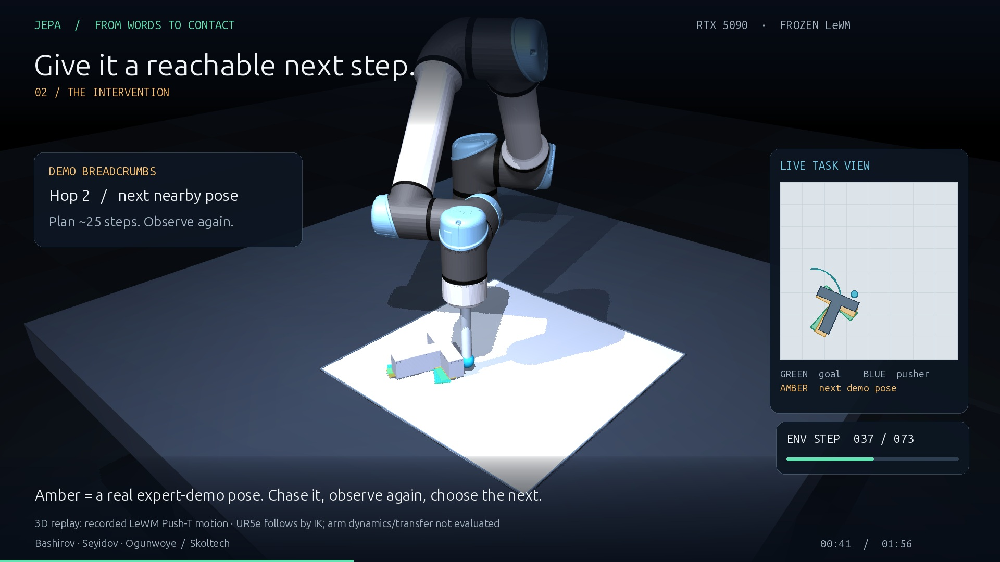

**[Watch: From words to contact — 60 seconds](media/JEPA_robot_demo.mp4)** · Actual frozen-LeWM Push-T trajectories visualized with a UR5e arm.

# Language over demo breadcrumbs

Alexander Bashirov · Didar Seyidov · Faith Ogunwoye — Skoltech

A frozen world model can plan useful short pushes. We give it nearby goals from expert demonstrations so it can tackle longer tasks, and let language choose the goal region.

**[Presentation (PPTX, speaker notes removed)](presentation/JEPA_defence_clean.pptx)** · **[Presentation (PDF)](presentation/JEPA_defence_clean.pdf)** · [Video evidence and reproduction](media/README.md)

## What worked—and what remains

| Saved experiment | Result |
|---|---|
| Demo goal 100 steps ahead, matched budget | Flat 10/50 → breadcrumbs 29/50 |
| Held-out sentence parsing | 101/120 correct (84.2%) |
| Language tasks, same 111 eligible cases | Gold command 57/111; parsed command 51/111 |
| Turn templates | 8/20 with <40 px drift; 0/20 with strict <15 px drift |
| Learned text-to-subgoal head | 18/111; shuffled text 10/111 |

The encoder and world model stay frozen. The demo graph uses simulator state for retrieval. Real-robot transfer remains future work: the video uses recorded Push-T physics and a UR5e kinematic visualization, rather than an evaluated robot-arm controller.

## Course archive

- [Experiment handoff and frozen claims](HANDOFF_5090.md)
- [Saved evaluation artifacts](research/artifacts/5090/)
- [Planner and language scripts](scripts/)
- [Reports](reports/)
- [Original LeWM source](le-wm/)
- [Setup notes](SETUP.md)
- [Presentation source and provenance](presentation/source/)

`media/` retains the new visualization captures, renderer source, robot-model attribution, and reproduction instructions. The final course snapshot also preserves the local run logs and trained subgoal-head artifacts. Downloadable upstream datasets, foundation-model caches and virtual environments are not bundled.
